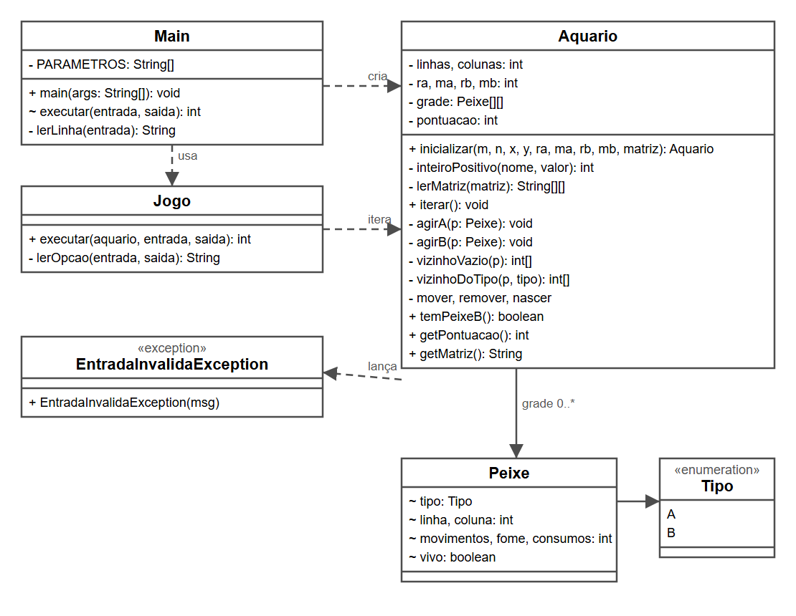
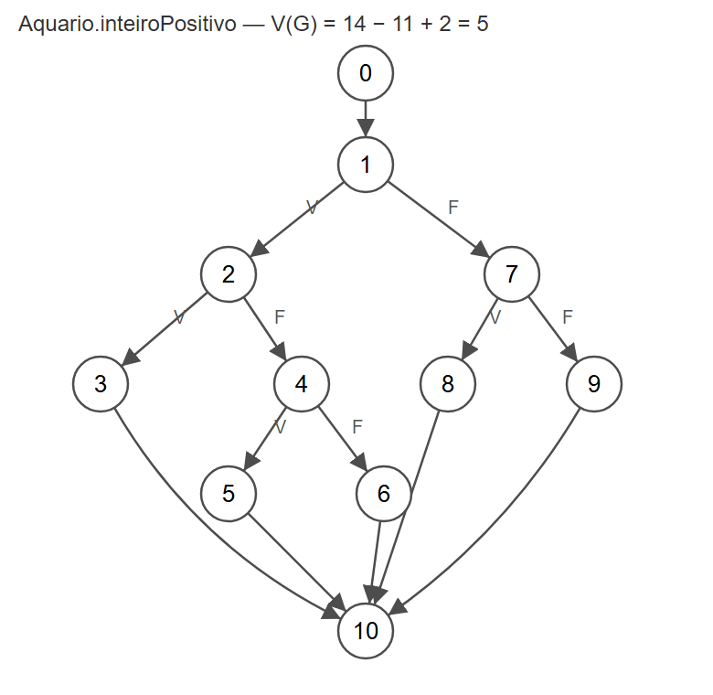
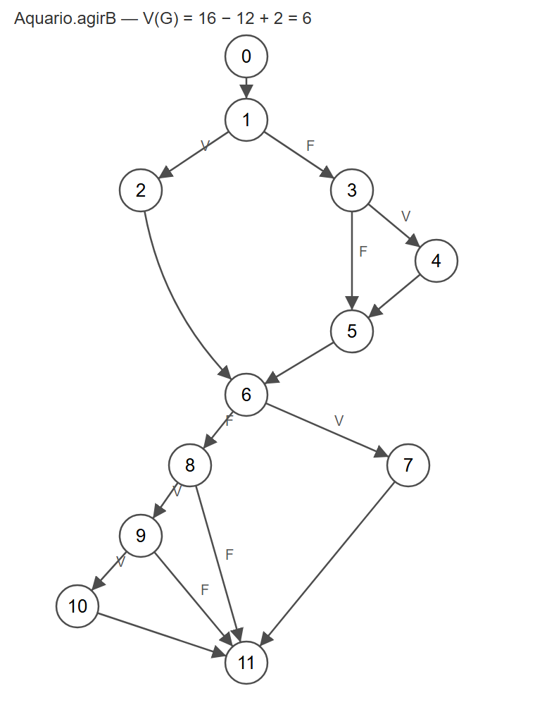
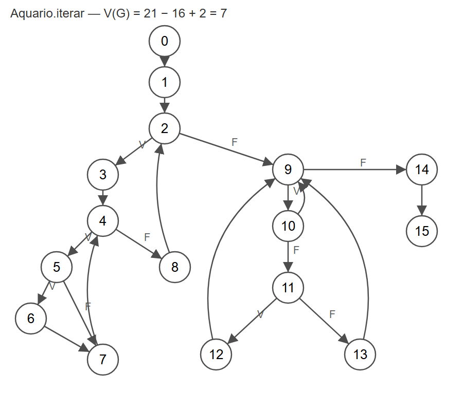

# Relatório da Parte II — Teste Estrutural do Jogo do Aquário

**Universidade Federal de Juiz de Fora — Departamento de Ciência da Computação**
**DCC168 Teste de Software — 2026-3 — Prof. André Luiz de Oliveira**

**Integrantes:** Hugo Amoglia Priori (202076035), Igor Westermann Lima (201876021) e Laura Neves (201976032)

**Repositório:** https://github.com/priorihugo/testes-de-software

> Rascunho mantido junto com o código. Cada ciclo de trabalho atualiza este arquivo no mesmo commit, de modo que o histórico do repositório mostra a ordem real em que testes e código foram escritos. Trechos marcados como **[A PREENCHER PELO GRUPO]** ou **[PRINT DO ECLIPSE]** dependem do grupo.

## Sumário

1. Introdução
2. Arquitetura e implementação
3. Parte II-A: automatização do teste funcional (TestSet-Func)
4. Parte II-B: aplicação do teste estrutural (TestSet-Estr)
   - 4.1 Método de trabalho
   - 4.2 Critérios baseados em fluxo de controle
   - 4.3 Critérios baseados em fluxo de dados
   - 4.4 Casos de teste estruturais
   - 4.5 Diário de execução
   - 4.6 Cobertura final e requisitos inalcançáveis
   - 4.7 Defeitos encontrados
5. Análise pessoal: eficiência e eficácia das técnicas
6. Pergunta ao grupo: influência dos casos funcionais (TDD)
7. Conclusão
8. Referências

## 1. Introdução

Este relatório apresenta a Parte II do trabalho de DCC168 para o Jogo do Aquário: a implementação do programa em Java, a automatização em JUnit dos 68 casos de teste funcionais especificados na Parte I (TestSet-Func) e a aplicação dos critérios de teste estrutural baseados em fluxo de controle e em fluxo de dados, que levou a 19 casos adicionais (TestSet-Estr).

A especificação usada é o documento da Parte I. As decisões de projeto D01–D11 definidas lá (vizinhança ortogonal, ordem de atualização, desempates e contadores) determinam as saídas esperadas e foram seguidas na implementação. As decisões novas surgidas durante a Parte II (D12–D15: limite de inteiros, formato dos parâmetros, colchetes da matriz e fim da entrada) foram incorporadas na revisão 1.2 do documento, que também registra a execução dos 68 casos na coluna Saída Obtida.

A cobertura foi medida com o JaCoCo, motor do EclEmma, e com o BA-DUA, motor do Baduíno, pela linha de comando (`scripts/cobertura.sh`). Os números e as figuras oficiais do EclEmma e do Baduíno vêm da execução no Eclipse, registrada nas seções 3 e 4.6.

## 2. Arquitetura e implementação



*Figura 1 — Diagrama de classes.*

| Classe | Responsabilidade |
|---|---|
| `Aquario` | Valida a entrada (`inicializar`), guarda a matriz e os parâmetros RA, MA, RB e MB, executa uma iteração (`iterar`) aplicando as regras de A (`agirA`) e de B (`agirB`) e informa o estado (`temPeixeB`, `getPontuacao`, `getMatriz`). |
| `Peixe` | Tipo, posição e contadores individuais: movimentos consecutivos, fome e consumos desde a última reprodução. |
| `Tipo` | Enumeração dos tipos A e B. |
| `Jogo` | Laço da partida: executa iterações, mostra a matriz, lê a opção C/E do jogador e informa a pontuação. |
| `Main` | Interface de console: lê M, N, X, Y, RA, MA, RB, MB e a matriz, e inicia o jogo. |
| `EntradaInvalidaException` | Sinaliza a recusa da inicialização (D03). |

Decisões de projeto relevantes para o teste:

- **Lógica separada da entrada e saída.** `Jogo.executar` recebe um `BufferedReader` e um `PrintStream`. Os testes simulam o teclado com um texto ("C\nE\n"), o que permite automatizar os casos de controle do jogo, como o CT25, que digita uma opção inválida.
- **Mesma notação da Parte I.** A matriz é lida e exibida no formato `[A . .; . . B]`, o que permitiu transcrever os 68 casos sem tradução manual.
- **Parâmetros recebidos como texto.** Assim, entradas não inteiras como "1.5" (classe I2) chegam ao programa e podem ser recusadas, em vez de falharem antes, na conversão.

## 3. Parte II-A — Automatização do teste funcional (TestSet-Func)

### 3.1 Implementação dos casos de teste

Os 68 casos da Tabela 2 da Parte I foram transcritos para `test/aquario/TestSetFunc.java`, um método por caso (`ct01` … `ct69`). A transcrição foi feita por um gerador que lê a tabela do documento, o que elimina erros de digitação e garante que nenhum caso foi acrescentado nesta subfase. Cada caso válido verifica a matriz exibida após cada iteração, o tipo de encerramento e a pontuação final; cada caso inválido verifica que a inicialização é recusada.

```java
/** CT25: V1–V6, V14–V23, V27, V33, I20. */
@Test
public void ct25() throws IOException {
    String saida = jogar(Aquario.inicializar("1", "4", "1", "1", "3", "3", "2", "3", "A . . B"), "Z\nC\nC\nE\n");
    assertIteracoes(saida, "[. A B .]", "[A B . .]", "[B . . .]");
    assertFim(saida, false, 3);
    assertEquals(1, ocorrencias(saida, "Opção inválida."));
}
```

*Listagem 1 — CT25: a opção inválida "Z" não avança a partida nem altera a pontuação.*

### 3.2 Resultado da execução

| Execução | Casos | Passaram | Falharam | Defeitos |
|---|---|---|---|---|
| 22/11/2026, commit `8409274` | 68 | 68 | 0 | nenhum |

A coluna Saída Obtida da Tabela 2 da Parte I foi preenchida com esse resultado na revisão 1.2 do documento.

**[PRINT DO ECLIPSE: JUnit com TestSetFunc — 68/68 passando]**

### 3.3 Cobertura do TestSet-Func

Cobertura do TestSet-Func sobre a versão final do código (a mesma usada nos prints do Eclipse):

| Ferramenta | Critério | Coberto | Total | % |
|---|---|---|---|---|
| JaCoCo (EclEmma) | Instruções | 1025 | 1264 | 81,1 |
| JaCoCo (EclEmma) | Desvios | 107 | 122 | 87,7 |
| JaCoCo (EclEmma) | Linhas | 171 | 201 | 85,1 |
| JaCoCo (EclEmma) | Métodos | 22 | 26 | 84,6 |
| BA-DUA (Baduíno) | Pares definição-uso | 464 | 547 | 84,8 |

Na primeira execução, sobre o código do commit `8409274`, os valores foram 80,8% das instruções, 87,9% dos desvios e 85,6% dos pares. A pequena diferença vem das mudanças dos ciclos 2 a 4, na validação de parâmetros e na remoção de verificações impossíveis.

**[PRINT DO ECLIPSE: view Coverage do EclEmma com TestSetFunc]**
**[PRINT DO ECLIPSE: view do Baduíno com TestSetFunc]**

Prévias geradas pela linha de comando, apenas para referência, em `docs/previas/`: `junit-func.png`, `jacoco-func.png`, `jacoco-func-Main.png` e `badua-func.png`.

O principal trecho não coberto é a classe `Main`, com 0%: nenhum caso funcional passa pela leitura do console, porque a Parte I especifica os casos a partir dos parâmetros e da matriz, não da digitação. Os demais trechos não cobertos são variações da leitura da matriz (colchetes, linha vazia) e alguns pares definição-uso de laços.

## 4. Parte II-B — Aplicação do teste estrutural (TestSet-Estr)

### 4.1 Método de trabalho

1. Para os seis métodos com mais decisões, os critérios de fluxo de controle e de fluxo de dados foram aplicados manualmente: grafo de fluxo de controle (GFC), complexidade ciclomática, caminhos independentes e associações definição-uso (seções 4.2 e 4.3).
2. Cada requisito foi associado a um caso existente que o exercita. Requisitos sem caso geraram casos novos, e requisitos impossíveis foram justificados.
3. Os relatórios das ferramentas foram usados para conferir a análise manual e para os demais métodos.
4. Os casos novos foram escritos antes de qualquer mudança no código, em ciclos registrados no diário (seção 4.5).

### 4.2 Critérios baseados em fluxo de controle

Para cada método são apresentados o código com os nós numerados, o GFC, a complexidade ciclomática calculada de duas formas, V(G) = E − N + 2 e V(G) = número de decisões + 1, e um conjunto de caminhos independentes com o caso de teste que executa cada um. O nó 0 representa a entrada do método e o último nó, a saída. Os critérios Todos-os-Nós e Todos-os-Arcos ficam satisfeitos pelos caminhos listados, que juntos percorrem todos os nós e arcos de cada grafo.

#### 4.2.1 `Aquario.inteiroPositivo`

```java
private static int inteiroPositivo(String nome, String valor) {       // nó 0
    String texto = valor.trim();                                      // nó 1
    if (texto.matches("-?\\d+")) {                                    // nó 1
        BigInteger numero = new BigInteger(texto);                    // nó 2
        if (numero.signum() <= 0) {                                   // nó 2
            throw new EntradaInvalidaException(... " não é positivo"); // nó 3
        }
        if (numero.bitLength() > 31) {                                // nó 4
            throw new EntradaInvalidaException(... " é grande demais"); // nó 5
        }
        return numero.intValue();                                     // nó 6
    }
    if (texto.matches("-?\\d*[.,]\\d+")) {                            // nó 7
        throw new EntradaInvalidaException(... " não é inteiro");     // nó 8
    }
    throw new EntradaInvalidaException(... " não é um inteiro ...");  // nó 9
}                                                                     // nó 10 (saída)
```



*Figura 2 — GFC de `Aquario.inteiroPositivo`.*

V(G) = 14 − 11 + 2 = **5** = 4 decisões + 1.

| Caminho | Nós | Situação | Caso |
|---|---|---|---|
| C1 | 0-1-2-3-10 | inteiro não positivo | CT36 (X=0) |
| C2 | 0-1-2-4-5-10 | inteiro maior que o limite de `int` | CE02 |
| C3 | 0-1-2-4-6-10 | inteiro positivo válido | CT01 |
| C4 | 0-1-7-8-10 | número decimal | CT37 (X=1.5) |
| C5 | 0-1-7-9-10 | outro formato | CE01 ("abc"), CE18 ("1e1") |

#### 4.2.2 `Aquario.agirA`

```java
private void agirA(Peixe p) {                   // nó 0
    int[] livre = vizinhoVazio(p);              // nó 1
    if (livre != null) {                        // nó 1
        mover(p, livre);                        // nó 2
        p.movimentos++;                         // nó 2
        p.fome = 0;                             // nó 2
    } else {
        p.movimentos = 0;                       // nó 3
        p.fome++;                               // nó 3
    }
    if (p.fome >= ma) {                         // nó 4
        remover(p);                             // nó 5
        return;                                 // nó 5
    }
    if (p.movimentos >= ra) {                   // nó 6
        nascer(Tipo.A, vizinhoVazio(p));        // nó 7
        p.movimentos = 0;                       // nó 7
    }
}                                               // nó 8 (saída)
```


*Figura 3 — GFC de `Aquario.agirA`.*

V(G) = 11 − 9 + 2 = **4** = 3 decisões + 1.

| Caminho | Nós | Situação | Caso |
|---|---|---|---|
| C1 | 0-1-2-4-6-8 | move, sobrevive, não reproduz | CT01 |
| C2 | 0-1-2-4-6-7-8 | move e reproduz | CT02 (RA=1) |
| C3 | 0-1-3-4-6-8 | bloqueado, sobrevive | CT20 |
| C4 | 0-1-3-4-5-8 | bloqueado, morre de fome | CT07 (MA=1) |

Dois caminhos do grafo são impossíveis e por isso não entram no conjunto: 0-1-2-4-5 (mover e morrer na mesma ação, pois mover zera a fome) e 0-1-3-4-6-7 (bloqueado e reproduzir, pois o bloqueio zera os movimentos). Correspondem às restrições E(C1, C2) e R(C3, C1) da revisão 1.1 da Parte I.

#### 4.2.3 `Aquario.agirB`

```java
private void agirB(Peixe p) {                                     // nó 0
    int[] presa = vizinhoDoTipo(p, Tipo.A);                       // nó 1
    if (presa != null) {                                          // nó 1
        grade[presa[0]][presa[1]].vivo = false;                   // nó 2
        mover(p, presa);                                          // nó 2
        p.consumos++;                                             // nó 2
        p.fome = 0;                                               // nó 2
    } else {
        int[] livre = vizinhoVazio(p);                            // nó 3
        if (livre != null) {                                      // nó 3
            mover(p, livre);                                      // nó 4
        }
        p.fome++;                                                 // nó 5
    }
    if (p.fome >= mb) {                                           // nó 6
        remover(p);                                               // nó 7
        return;                                                   // nó 7
    }
    if (p.consumos >= rb                                          // nó 8
            && vizinhoDoTipo(p, Tipo.B) == null) {                // nó 9
        nascer(Tipo.B, vizinhoVazio(p));                          // nó 10
        p.consumos = 0;                                           // nó 10
    }
}                                                                 // nó 11 (saída)
```



*Figura 4 — GFC de `Aquario.agirB`. A condição composta da linha 195 foi separada nos nós 8 e 9, pois o `&&` só avalia a segunda parte se a primeira for verdadeira.*

V(G) = 16 − 12 + 2 = **6** = 5 decisões + 1.

| Caminho | Nós | Situação | Caso |
|---|---|---|---|
| C1 | 0-1-2-6-8-11 | come, ainda abaixo de RB | CT12 (RB=2) |
| C2 | 0-1-2-6-8-9-10-11 | come, atinge RB, isolado: reproduz | CT14 (RB=1) |
| C3 | 0-1-2-6-8-9-11 | come, atinge RB, mas tem B vizinho | CT15 |
| C4 | 0-1-3-4-5-6-8-11 | move para célula livre e sobrevive | CT01 |
| C5 | 0-1-3-5-6-8-11 | sem presa nem espaço: permanece | CT20 |
| C6 | 0-1-3-4-5-6-7-11 | move sem comer e morre de fome | CT16 (MB=1) |

O caminho 0-1-3-4-5-6-8-9-10-11, reprodução adiada de um B que já tinha consumos suficientes e só agora ficou isolado, também é executado, pelo CT22 na 4ª iteração. O caminho 0-1-2-6-7 (comer e morrer de fome na mesma ação) é impossível, porque comer zera a fome.

#### 4.2.4 `Aquario.iterar`

```java
public void iterar() {                                    // nó 0
    List<Peixe> ordem = new ArrayList<Peixe>();           // nó 1
    for (int i = 0; i < linhas; i++) {                    // nó 1 (i = 0), nó 2 (i < linhas), nó 8 (i++)
        for (int j = 0; j < colunas; j++) {               // nó 3 (j = 0), nó 4 (j < colunas), nó 7 (j++)
            if (grade[i][j] != null) {                    // nó 5
                ordem.add(grade[i][j]);                   // nó 6
            }
        }
    }
    for (Peixe p : ordem) {                               // nó 9 (há próximo?)
        if (!p.vivo) {                                    // nó 10
            continue;                                     // volta ao nó 9
        }
        if (p.tipo == Tipo.A) {                           // nó 11
            agirA(p);                                     // nó 12
        } else {
            agirB(p);                                     // nó 13
        }
    }
    pontuacao++;                                          // nó 14
}                                                         // nó 15 (saída)
```



*Figura 5 — GFC de `Aquario.iterar`.*

V(G) = 21 − 16 + 2 = **7** = 6 decisões + 1.

Em métodos com laços, os caminhos independentes se distinguem pelos arcos que percorrem dentro de cada volta. Todos os arcos são exercitados:

| Arcos | Situação | Caso |
|---|---|---|
| 2→3, 4→5, 5→6, 6→7, 7→4, 4→8, 8→2, 2→9 | percorre a matriz e coleta os peixes | todos os casos válidos |
| 5→7 | célula vazia | CT01 |
| 9→10, 10→11, 11→12, 12→9 | peixe A age | CT01 |
| 11→13, 13→9 | peixe B age | CT01 |
| 10→9 | peixe já consumido é ignorado | CT12 |
| 9→14, 14→15 | fim da lista e soma da pontuação | todos os casos válidos |

Não há caminho em que um dos laços termine sem dar nenhuma volta, porque M e N são sempre pelo menos 1. Esses são os pares inalcançáveis do grupo 1 da seção 4.6.

#### 4.2.5 `Jogo.executar`

```java
public static int executar(Aquario aquario, BufferedReader entrada, PrintStream saida) throws IOException { // nó 0
    while (true) {
        aquario.iterar();                                              // nó 1
        saida.println("Iteração " + ...);                              // nó 1
        if (!aquario.temPeixeB()) {                                    // nó 2
            saida.println("Não há mais peixes B. Fim de jogo.");       // nó 3
            break;                                                     // nó 3
        }
        if (lerOpcao(entrada, saida).equals("E")) {                    // nó 4
            saida.println("Jogo encerrado pelo jogador.");             // nó 5
            break;                                                     // nó 5
        }
    }
    saida.println("Pontuação final: " + aquario.getPontuacao());       // nó 6
    return aquario.getPontuacao();                                     // nó 6
}                                                                      // nó 7 (saída)
```


*Figura 6 — GFC de `Jogo.executar`.*

V(G) = 9 − 8 + 2 = **3** = 2 decisões + 1.

| Caminho | Nós | Situação | Caso |
|---|---|---|---|
| C1 | 0-1-2-3-6-7 | sem B após a iteração: encerra sozinho | CT16 |
| C2 | 0-1-2-4-5-6-7 | jogador escolhe E | CT01 |
| C3 | 0-1-2-4-1-2-4-5-6-7 | jogador escolhe C e depois E | CT04 |

#### 4.2.6 `Jogo.lerOpcao`

```java
private static String lerOpcao(BufferedReader entrada, PrintStream saida) throws IOException { // nó 0
    while (true) {
        saida.print("Digite C para continuar ou E para encerrar: ");  // nó 1
        String linha = entrada.readLine();                            // nó 1
        if (linha == null) {                                          // nó 2
            return "E";                                               // nó 3
        }
        String opcao = linha.trim();                                  // nó 4
        if (opcao.equals("C")                                         // nó 4
                || opcao.equals("E")) {                               // nó 5
            return opcao;                                             // nó 6
        }
        saida.println("Opção inválida.");                             // nó 7
    }
}                                                                     // nó 8 (saída)
```


*Figura 7 — GFC de `Jogo.lerOpcao`.*

V(G) = 11 − 9 + 2 = **4** = 3 decisões + 1.

| Caminho | Nós | Situação | Caso |
|---|---|---|---|
| C1 | 0-1-2-3-8 | a entrada terminou | CE09 |
| C2 | 0-1-2-4-6-8 | opção C | CT04 |
| C3 | 0-1-2-4-5-6-8 | opção E | CT01 |
| C4 | 0-1-2-4-5-7-1-2-4-6-8 | opção inválida e depois C | CT25 |

### 4.3 Critérios baseados em fluxo de dados

Para os mesmos métodos, as tabelas abaixo listam as associações definição-uso. Um **c-uso** é o uso de uma variável em um cálculo ou chamada, associado ao nó; um **p-uso** é o uso em uma condição, associado a cada arco que sai da decisão. Satisfazer **todos-os-usos** implica satisfazer **todas-as-definições**, **todos-os-c-usos** e **todos-os-p-usos**, e é o critério medido pelo BA-DUA. Atributos do objeto (como `ma` e `p.fome`) aparecem definidos no nó 0 quando o valor vem de fora do método, de uma chamada anterior ou da construção do aquário.

#### 4.3.1 `inteiroPositivo`

| Variável | Definição | Uso | Tipo | Caso |
|---|---|---|---|---|
| valor | 0 | 1 | c-uso | CT01 |
| valor, nome | 0 | 3 / 5 / 8 / 9 | c-uso (mensagem) | CT36 / CE02 / CT37 / CE01 |
| texto | 1 | (1,2) e (1,7) | p-uso | CT01 e CT37 |
| texto | 1 | 2 | c-uso | CT01 |
| texto | 1 | (7,8) e (7,9) | p-uso | CT37 e CE01 |
| numero | 2 | (2,3) e (2,4) | p-uso | CT36 e CT01 |
| numero | 2 | (4,5) e (4,6) | p-uso | CE02 e CT01 |
| numero | 2 | 6 | c-uso | CT01 |

Todas as associações são alcançáveis e estão cobertas.

#### 4.3.2 `agirA`

| Variável | Definição | Uso | Tipo | Caso |
|---|---|---|---|---|
| livre | 1 | (1,2) e (1,3) | p-uso | CT01 e CT20 |
| livre | 1 | 2 | c-uso | CT01 |
| p.movimentos | 0 | 2 (`++`) | c-uso | CT01 |
| p.fome | 0 | 3 (`++`) | c-uso | CT20 |
| p.fome | 2 | (4,6) | p-uso | CT01 |
| p.fome | 2 | (4,5) | p-uso | **inalcançável**: fome 0 nunca atinge MA ≥ 1 |
| p.fome | 3 | (4,5) e (4,6) | p-uso | CT07 e CT20 |
| p.movimentos | 2 | (6,7) e (6,8) | p-uso | CT02 e CT01 |
| p.movimentos | 3 | (6,8) | p-uso | CT20 |
| p.movimentos | 3 | (6,7) | p-uso | **inalcançável**: 0 movimentos nunca atinge RA ≥ 1 |
| ma | 0 | (4,5) e (4,6) | p-uso | CT07 e CT01 |
| ra | 0 | (6,7) e (6,8) | p-uso | CT02 e CT01 |

#### 4.3.3 `agirB`

| Variável | Definição | Uso | Tipo | Caso |
|---|---|---|---|---|
| presa | 1 | (1,2) e (1,3) | p-uso | CT12 e CT01 |
| presa | 1 | 2 | c-uso | CT12 |
| livre | 3 | (3,4) e (3,5) | p-uso | CT01 e CT20 |
| livre | 3 | 4 | c-uso | CT01 |
| p.fome | 0 | 5 (`++`) | c-uso | CT01 |
| p.fome | 2 | (6,8) | p-uso | CT12 |
| p.fome | 2 | (6,7) | p-uso | **inalcançável**: comer zera a fome |
| p.fome | 5 | (6,7) e (6,8) | p-uso | CT16 e CT01 |
| p.consumos | 0 | 2 (`++`) | c-uso | CT12 |
| p.consumos | 0 | (8,9) | p-uso | CT22 (reprodução adiada, sem comer) |
| p.consumos | 0 | (8,11) | p-uso | CT01 |
| p.consumos | 2 | (8,9) e (8,11) | p-uso | CT14 e CT12 |
| mb | 0 | (6,7) e (6,8) | p-uso | CT16 e CT01 |
| rb | 0 | (8,9) e (8,11) | p-uso | CT14 e CT01 |

#### 4.3.4 `iterar`, `executar` e `lerOpcao`

| Método | Variável | Definição | Uso | Caso |
|---|---|---|---|---|
| `iterar` | ordem | 1 | 6 (c-uso), 9 (c-uso) | CT01 |
| `iterar` | p | 9 | (10,9), (10,11) | CT12 e CT01 |
| `iterar` | p | 9 | (11,12), (11,13), 12, 13 | CT01 |
| `iterar` | i, j | 1 / 3 (inicial) | arcos de saída sem volta | **inalcançáveis**: M, N ≥ 1 |
| `executar` | aquario | 0 | 1, 2, 6 | CT01 |
| `lerOpcao` | linha | 1 | (2,3) e (2,4) | CE09 e CT01 |
| `lerOpcao` | linha | 1 | 4 | CT01 |
| `lerOpcao` | opcao | 4 | (4,6) e (4,5) | CT04 e CT01 |
| `lerOpcao` | opcao | 4 | (5,6) e (5,7) | CT01 e CT25 |
| `lerOpcao` | opcao | 4 | 6 | CT04 |

### 4.4 Casos de teste estruturais (TestSet-Estr)

Implementados em `test/aquario/TestSetEstr.java`. "Recusar" significa lançar `EntradaInvalidaException` sem iniciar a partida.

| ID | Condições de entrada | Saída esperada | Requisito estrutural | Saída obtida |
|---|---|---|---|---|
| CE01 | X="abc" | Recusar | `inteiroPositivo`, caminho C5 | Conforme esperado |
| CE02 | RA="99999999999" | Recusar | `inteiroPositivo`, caminho C2 | Conforme esperado |
| CE03 | Matriz "[A . . B]" (com colchetes) | Aceitar; matriz "[A . . B]" | `lerMatriz`, desvio dos colchetes | Conforme esperado |
| CE04 | Matriz "[A . . B" (sem fechar) | Recusar | `lerMatriz`, abre sem fechar | Conforme esperado |
| CE05 | M=2, N=2, matriz "A B;" | Recusar (linha vazia) | `lerMatriz`, linha vazia | Conforme esperado |
| CE06 | M=2, N=2, matriz "A; B ." | Recusar (1ª linha curta) | `inicializar`, par de `i` inicial | Conforme esperado |
| CE07 | M=1, N=3, X=1, Y=1, matriz "B . ." | Recusar (sem A) | `inicializar`, par de `contaA` = 0 | Conforme esperado |
| CE08 | M=2, N=2, matriz "? A; . B" | Recusar (símbolo em (1,1)) | `inicializar`, pares de `i` e `j` iniciais | Conforme esperado |
| CE09 | CT01 sem digitar nada | 1 iteração; encerra; pontuação 1 | `lerOpcao`, caminho C1 | Conforme esperado |
| CE10 | Console: CT01 seguido de C e E | Matriz inicial e 2 iterações; pontuação 2 | `Main.executar`, inicialização válida | Conforme esperado |
| CE11 | Console: X=0 | "Inicialização recusada" | `Main.executar`, captura da exceção | Conforme esperado |
| CE12 | Console: M="abc" | "Inicialização recusada: M=abc" | `Main.executar`, M não numérico | Conforme esperado |
| CE13 | Console: entrada termina após "1" | "Inicialização recusada" | `Main.lerLinha`, fim da entrada | Conforme esperado |
| CE14 | `Main.main` lendo "A B" com E | Iteração 1 "[B .]"; pontuação 1 | `Main.main` | Conforme esperado |
| CE15 | Console: M=2, N=2, matriz "B ." / ". A", E | Matriz inicial "[B .; . A]"; iteração "[. A; B .]" | `Main.executar`, matriz com várias linhas | Conforme esperado |
| CE16 | M=2, N=2, matriz "A B; ? ." | Recusar (símbolo em (2,1)) | `inicializar`, par de `i` incrementado | Conforme esperado |
| CE17 | RA="2.0" | Recusar | D13 (ciclo 2) | Conforme esperado após o ciclo 2b |
| CE18 | MA="1e1" | Recusar | D13; `inteiroPositivo`, caminho C5 | Conforme esperado após o ciclo 2b |
| CE19 | RB="+3" | Recusar | D13 | Conforme esperado após o ciclo 2b |

```java
/** CE17: inteiro escrito com casa decimal é recusado (decisão D13, revisão 1.2 da Parte I). */
@Test(expected = EntradaInvalidaException.class)
public void ce17ParametroComCasaDecimalZero() {
    Aquario.inicializar("1", "4", "1", "1", "2.0", "3", "3", "3", "A . . B");
}
```

*Listagem 2 — CE17, escrito e executado (falhando) antes da correção do código.*

### 4.5 Diário de execução

Cada ciclo registra o que foi escrito primeiro (teste), o resultado da execução, a mudança no código e o resultado final. Os commits do repositório seguem a mesma ordem.

| Ciclo | Data | Testes escritos | Resultado dos testes novos | Mudança no código | Resultado final |
|---|---|---|---|---|---|
| 0 | 22/11/2026 19:53 | CE01–CE14: parâmetro não numérico e grande demais, colchetes na matriz, linha vazia, primeira linha com tamanho errado, matriz sem A, símbolo inválido em (1,1), fim da entrada na escolha, quatro caminhos do `Main` | 14 passaram de primeira; nenhum defeito | nenhuma | 82/82 passam; JaCoCo 99,4% instruções, 97,6% desvios; BA-DUA 516/548 (94,2%) |
| 1 | 22/11/2026 19:56 | CE15: matriz de duas linhas lida pelo `Main` (único desvio alcançável ainda não coberto); CE16: símbolo inválido na célula (2,1) (par definição-uso de `i` incrementado) | 2 passaram de primeira; nenhum defeito | nenhuma | 84/84 passam; JaCoCo 99,8% instruções, 98,4% desvios; BA-DUA 522/548 (95,3%) |
| 2a | 22/11/2026 19:58 | CE17–CE19: "2.0", "1e1" e "+3" devem ser recusados (nova decisão D13: parâmetro aceito só se escrito apenas com dígitos) | **3 falharam** (vermelho): o código aceitava os três, convertendo para 2, 10 e 3 | — (commit só dos testes) | 84/87 passam |
| 2b | 22/11/2026 20:01 | — | — | `Aquario.inteiroPositivo` passa a classificar pelo formato: só dígitos (depois positivo e tamanho), número decimal ("não é inteiro", classe I2) ou outro formato (recusado) | CE17–CE19 passam. **CE12 falhou**: conferia a mensagem literal "M=abc não é um número", que mudou. Como D03 não fixa mensagens literais, o defeito era do teste; o CE12 passou a verificar só a recusa de M. Depois disso, 87/87 passam; JaCoCo 99,8% instruções, 98,4% desvios; BA-DUA 529/555 (95,3%) |
| 3 | 22/11/2026 20:03 | nenhum (refatoração: os testes existentes precisam continuar verdes) | — | Removidas as verificações "não há célula para o filho" em `agirA` e `agirB`, que nunca podem ser verdadeiras pelas restrições R(C3, C4) e I(C9, C10) da revisão 1.1 da Parte I; o motivo ficou em comentário no código | 87/87 passam; JaCoCo 100% desvios, 99,8% instruções; BA-DUA 523/547 (95,6%) |
| 4 | 22/11/2026 20:05 | nenhum (refatoração) | — | Construtor privado em `Main`, que o JaCoCo não conta como método a cobrir (antes, o construtor implícito aparecia como método não coberto) | 87/87 passam; JaCoCo 100% em instruções, desvios, linhas e métodos; BA-DUA 523/547 (95,6%) |

**Correção de medição (22/11/2026 20:08).** Os percentuais do BA-DUA registrados antes desta data estavam inflados: o script de resumo contava o texto `covered="1"` no XML, que também aparece nos totalizadores por método. A contagem passou a somar o relatório de texto do BA-DUA (`badua.txt`), que é a contagem oficial da ferramenta, e todos os valores acima foram recalculados executando o script corrigido em cada commit. O XML não serve para contar porque agrupa pares que caem na mesma linha e omite variáveis sem nome no código.

### 4.6 Cobertura final e requisitos inalcançáveis

| Ferramenta | Critério | TestSet-Func | TestSet-Func + TestSet-Estr |
|---|---|---|---|
| JaCoCo (EclEmma) | Instruções | 81,1% | **100%** (1264/1264) |
| JaCoCo (EclEmma) | Desvios | 87,7% | **100%** (122/122) |
| JaCoCo (EclEmma) | Linhas | 85,1% | **100%** (201/201) |
| JaCoCo (EclEmma) | Métodos | 22/26 | **100%** (26/26) |
| BA-DUA (Baduíno) | Pares definição-uso | 84,8% | **95,6%** (523/547) |


*Figura 8 — Relatório HTML do JaCoCo com os dois conjuntos (linha de comando).*

**[PRINT DO ECLIPSE: view Coverage do EclEmma com os dois conjuntos]**
**[PRINT DO ECLIPSE: view do Baduíno com os dois conjuntos]**

Os 24 pares definição-uso não cobertos são inalcançáveis e estão justificados um a um em `docs/pares-inalcancaveis.md`:

| Grupo | Pares | Motivo |
|---|---|---|
| Laços que sempre dão pelo menos uma volta | 13 | M, N ≥ 1; `DIRECOES` tem 4 elementos; `PARAMETROS` tem 8 |
| Contagem zero igual à declaração | 2 | X, Y ≥ 1: uma matriz sem A ou sem B é sempre recusada |
| Combinações proibidas pelas regras | 3 | mover zera a fome de A; o bloqueio zera os movimentos; comer zera a fome de B |
| Primeira volta contra as demais | 6 | `i > 0` é sempre falso na primeira volta e sempre verdadeiro nas outras |

Descontados os inalcançáveis, a cobertura dos pares alcançáveis é de 100% (523/523). Não se reescreveram os laços para que a ferramenta deixasse de enxergar esses pares, pois isso mudaria o código sem benefício de comportamento.

### 4.7 Defeitos encontrados

| Fase | Onde | Defeito | Como apareceu | Correção |
|---|---|---|---|---|
| II-A | — | nenhum | 68/68 casos funcionais passaram | — |
| II-B | `Aquario.inteiroPositivo` | Parâmetros "2.0", "1e1" e "+3" eram aceitos como inteiros | CE17–CE19, escritos antes da mudança (ciclo 2a) | Validação pelo formato (ciclo 2b) |
| II-B | Teste CE12 | Conferia uma mensagem literal, contrariando D03 | Falhou quando a mensagem mudou (ciclo 2b) | Passou a verificar só a recusa |

## 5. Análise pessoal: eficiência e eficácia das técnicas

**[A PREENCHER PELO GRUPO]** — a especificação pede a análise do grupo. Fatos registrados neste trabalho que podem apoiar a análise:

- O teste funcional (68 casos) não revelou defeitos e cobriu 81,1% das instruções e 84,8% dos pares definição-uso na versão final do código.
- O que o teste funcional não alcançou foi principalmente a interface de console e variações de formato da entrada, que a especificação da Parte I não detalha.
- O teste estrutural acrescentou 19 casos e levou o fluxo de controle a 100%. Revelou um defeito de validação (ciclo 2) e um teste mal especificado (CE12).
- A análise manual de fluxo de dados identificou os mesmos pares inalcançáveis que o BA-DUA apontou, e as restrições da Parte I explicam vários deles.
- A medição automática também pode errar: o script de resumo inflou o percentual do BA-DUA até ser conferido com o relatório da própria ferramenta.

## 6. Pergunta ao grupo: influência dos casos funcionais (TDD)

> "Ao desenvolver o programa, vocês sentiram que foram influenciados por terem criado os casos de teste funcionais primeiro? Se sim, como isso refletiu no código?"

**[A PREENCHER PELO GRUPO]** — a resposta precisa refletir a experiência real do grupo. Fatos verificáveis: os casos funcionais foram especificados e entregues em 13/10/2026, e a implementação foi escrita em 22/11/2026 com auxílio de assistente de IA, já tendo os casos como alvo. A separação entre `Aquario`, `Jogo` e `Main` e a notação de matriz igual à da Parte I foram escolhidas para que os casos pudessem ser executados diretamente. Na Parte II-B, os testes foram escritos antes de cada mudança no código, como registra o diário.

## 7. Conclusão

A implementação passou nos 68 casos funcionais da Parte I sem defeitos. A aplicação dos critérios estruturais, feita manualmente nos métodos principais e conferida pelas ferramentas, levou a 19 casos novos, a 100% em todos os critérios de fluxo de controle do JaCoCo e a 100% dos pares definição-uso alcançáveis do BA-DUA. Os 24 pares restantes são inalcançáveis e justificados. O trabalho estrutural encontrou um defeito de validação de entrada e um teste mal especificado, ambos corrigidos em ciclos registrados, com os testes escritos antes das mudanças.

## 8. Referências

- OLIVEIRA, A. L. DCC168 Teste de Software: especificação do trabalho final. UFJF, 2026-3.
- Documento da Parte I — Teste Funcional do Jogo do Aquário, revisões 1.0, 1.1 e 1.2.
- JaCoCo — Java Code Coverage Library. https://www.jacoco.org/jacoco/
- EclEmma — Java Code Coverage for Eclipse. https://www.eclemma.org/
- BA-DUA — Data-flow testing coverage for Java. https://github.com/saeg/ba-dua
- Baduíno — BA-DUA plug-in for Eclipse. https://github.com/saeg/baduino
- JUnit 4. https://junit.org/junit4/
- McCABE, T. J. A complexity measure. IEEE Transactions on Software Engineering, SE-2(4), p. 308–320, 1976.
- RAPPS, S.; WEYUKER, E. J. Selecting software test data using data flow information. IEEE Transactions on Software Engineering, SE-11(4), p. 367–375, 1985.
